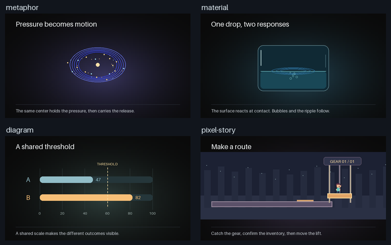

# 四类代码动画

一个面向 Codex 的动效短片 Skill。它从视觉隐喻、物体状态、变量图解和像素剧情四种方式中选择最适合当前内容的一种，再用统一事件表制作画面和声音。成片分别验收画面丰富度、动效丰富度和音效丰富度。



| 原创示例 | 可看的制作原理 |
| --- | --- |
| [视觉隐喻](examples/metaphor.mp4) | 同一中心从压缩到释放，短冲击接持续扩张声 |
| [物体状态](examples/material.mp4) | 落点触发涟漪，气泡与余波稍后出现 |
| [变量图解](examples/diagram.mp4) | 同尺度对照，数值跨阈值才触发确认 |
| [像素剧情](examples/pixel-story.mp4) | 走到道具旁，先接触再计数，最后驱动升降台 |

## 在 Codex 里使用

将仓库目录保存为 `four-style-motion-video`，放到 Codex 的 `skills` 目录。默认位置为 `~/.codex/skills/`，Windows 对应用户目录下的 `.codex\skills\`。打开后可以输入 `$four-style-motion-video` 并补充主题、目标画幅和声音要求。已经有 `video-creation-director` 的环境可在其动效路由中引用本 Skill。

```text
用 $four-style-motion-video 做一条关于练习反馈的竖屏知识动画。选择合适的画面逻辑，交付动作和氛围分轨，并核验三项丰富度。
```

## 重跑原创示例

使用 Python 3.12 和带 H.264、AAC 编码的 FFmpeg、ffprobe。示例使用下列依赖版本。

```bash
python -m pip install -r requirements.txt
python scripts/render_examples.py --out rendered
python scripts/render_examples.py --style material --out rendered
```

也可用 `--ffmpeg` 和 `--ffprobe` 指定路径。每段输出五秒 MP4、动作和氛围 WAV、混音 WAV 及动作时间表。演示画面、声音和图形由脚本生成。字幕采用 Pillow 随库字体，实际中文成片应选能完整覆盖所需字形的字体。

## 文件和使用范围

- [SKILL.md](SKILL.md) 是入口，[四类风格](references/styles.md)、[声音设计](references/sound-design.md)、[三项验收](references/review.md) 按需阅读。
- [样片复盘](references/cases.md) 记录可迁移的方法、公开出处和验证范围。仓库收录原创代码、说明及其演示视频和配图。第三方参考仅以公开链接引用。
- 示例的技术验证包括逐帧渲染、实际音画解码、帧时间及 WAV 时长。正式作品的连续观看和听审按各自成片记录。

代码、原创文档和演示按 [MIT](LICENSE) 发布。
